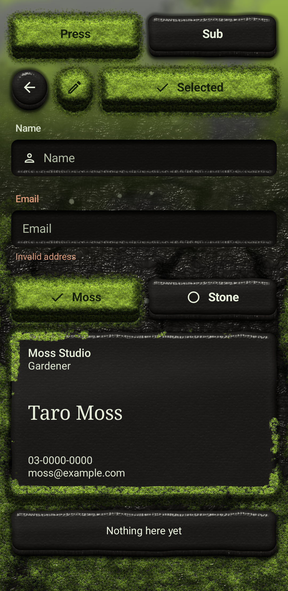
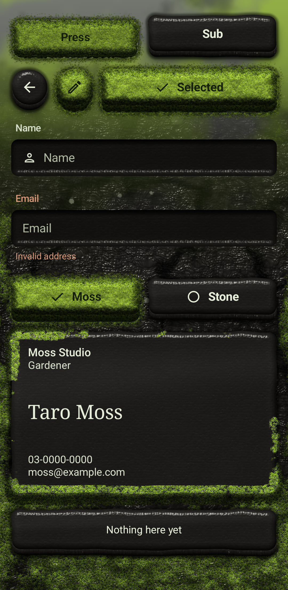
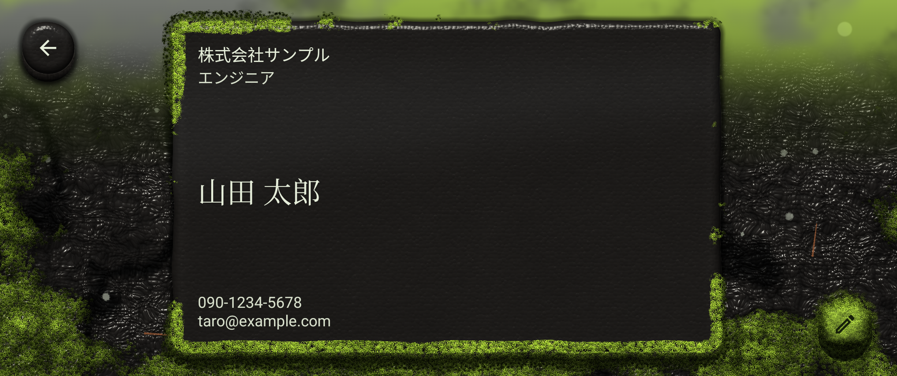
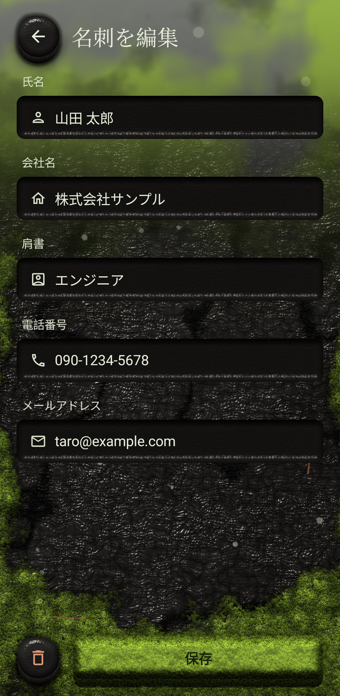
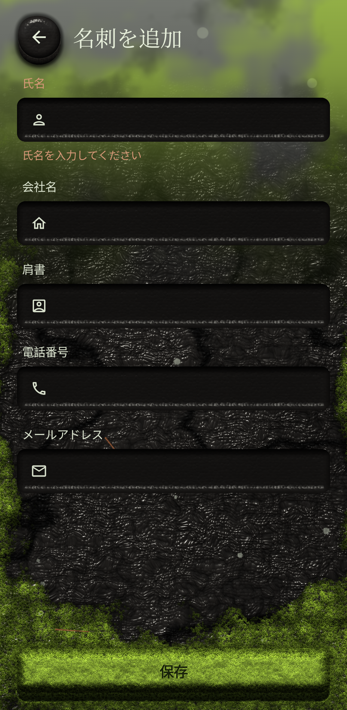
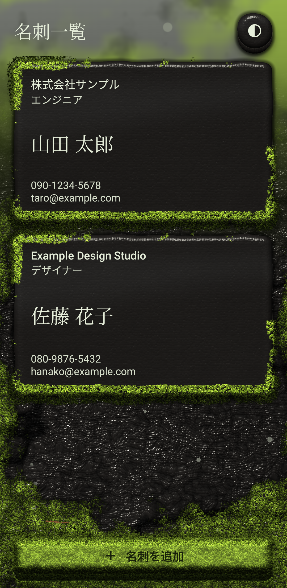
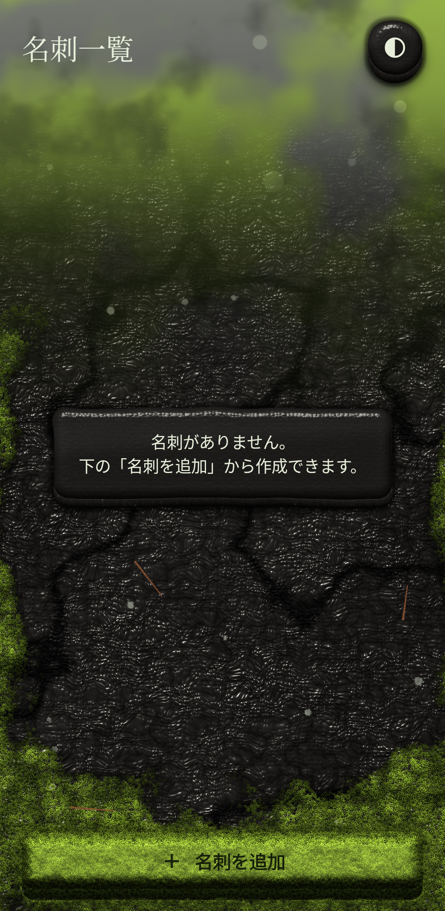
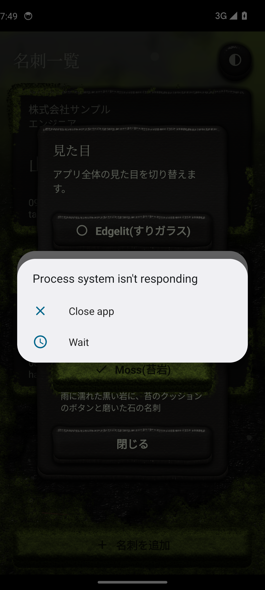

# Screenshots

a5bbb57(theme/moss)のスクリーンショット(Androidエミュレータ API 34 / Pixel 6 で *ScreenshotTest が撮影)

## 動き(登場 → ボタンを押して離す → スイッチ → トグル → タブ)

動かない場合は [GIF版](interactions.gif)

## catalog

## catalog_pressed

## detail

## edit

## edit_new_error

## list

## list_empty

## moss_catalog

## moss_catalog_pressed

## moss_detail

## moss_edit

## moss_edit_new_error

## moss_list

## moss_list_empty

## moss_theme_dialog

## porcelain_catalog

## porcelain_catalog_pressed

## porcelain_detail

## porcelain_edit

## porcelain_edit_new_error

## porcelain_list

## porcelain_list_empty

## porcelain_theme_dialog

